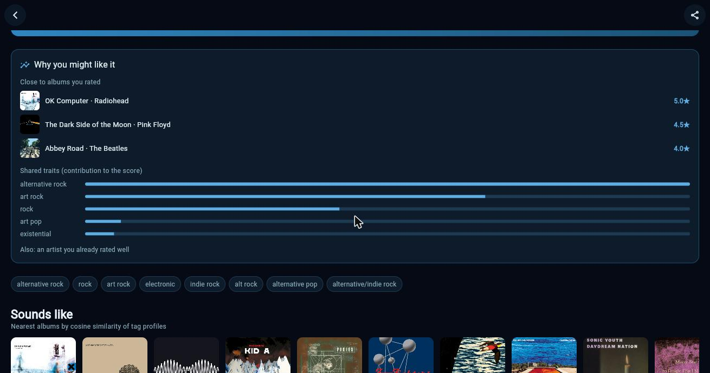

# cadence — recomendação de álbuns que explica o porquê

**Demo:** https://danmartsarr.github.io/cadence/ (entre em *Try the demo*, avalie três álbuns)

Você avalia discos de 0,5 a 5 estrelas e o app recomenda outros, sempre dizendo
**por que**: quais das suas avaliações pesaram e quais características
(gênero, clima, época) o disco divide com o seu gosto. Nada de caixa-preta.

| Início | Por que você pode gostar |
|---|---|
|  |  |

## Como funciona

O modelo é **baseado em conteúdo** e roda inteiro no aparelho, sem servidor:

1. **Catálogo** — `tools/build_catalog.py` busca 338 álbuns no
   [MusicBrainz](https://musicbrainz.org) (tags da comunidade, notas, faixas) e
   as capas no [Cover Art Archive](https://coverartarchive.org). Tags-ruído
   ("vinyl", "albums i own", anos) são removidas.
2. **Representação** — cada álbum vira um vetor **TF-IDF** das tags, com o
   artista como dimensão extra. Tag rara (ex.: *shoegaze*) diz mais que tag
   comum (*rock*).
3. **Perfil do usuário** — soma dos vetores dos álbuns avaliados, com peso
   centrado na nota (Rocchio): 5★ puxa para perto, 1★ empurra para longe.
4. **Ranking** — cosseno entre perfil e álbuns não avaliados.
5. **Diversidade** — **MMR** (*Maximal Marginal Relevance*) reordena para não
   entregar dez discos iguais.
6. **Explicação** — decompõe o escore em contribuição por tag e por álbum
   avaliado; é isso que aparece em *Why you might like it*.

Também: *Deep cuts* (mesmo gosto, discos menos votados), *Sounds like*
(vizinhos mais próximos) e favoritos da comunidade por **média bayesiana**
(um voto 5★ não passa na frente de 40 votos 4,6★).

Código do modelo: [`lib/shared/recommender/recommender.dart`](lib/shared/recommender/recommender.dart).

## Avaliação

Sem avaliações de usuários reais, a tarefa-proxy é **recuperar o artista**:
esconde-se o artista e mede-se se só as tags põem outros discos dele entre os
10 vizinhos mais próximos (100 consultas).

| Representação | recall@10 | hit@10 | MRR |
|---|---:|---:|---:|
| aleatório | 0,015 | 0,020 | 0,019 |
| contagem bruta das tags | 0,800 | 0,860 | 0,635 |
| **TF-IDF (usado no app)** | **0,830** | **0,880** | **0,660** |

Verifiquei que nenhuma tag contém o nome do artista (não há vazamento).
É uma medida conservadora: discos parecidos de artistas diferentes contam como
erro. Reproduzir: `python3 tools/evaluate.py` (sem dependências).

## Rodar

```bash
flutter pub get
flutter test                 # testes do recomendador
flutter run -d chrome        # ou: flutter build web
python3 tools/evaluate.py    # avaliação offline
python3 tools/build_catalog.py   # regenera o catálogo (≈10 min, respeita o limite do MusicBrainz)
```

Flutter 3 · Riverpod · go_router · avaliações salvas no aparelho
(`shared_preferences`). O login é simulado: serve só para a navegação do
protótipo.

## Próximos passos

- Filtragem colaborativa quando houver avaliações de várias pessoas (modelo híbrido)
- Embeddings de áudio (ex.: espectrogramas) para álbuns com poucas tags
