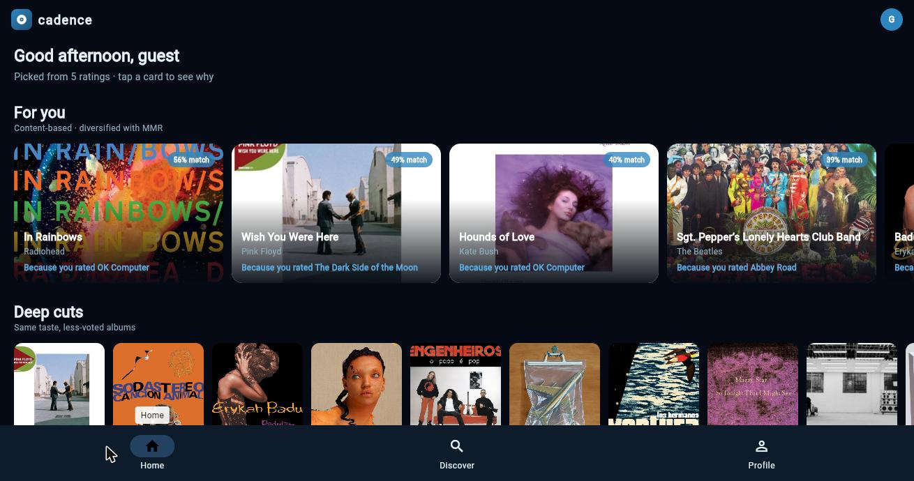

# cadence — album recommendations that explain why

**Demo:** https://danmartsarr.github.io/cadence/ (tap *Try the demo*, rate three albums)

Rate albums from 0.5 to 5 stars and the app recommends others, always saying
**why**: which of your ratings mattered and which traits (genre, mood, era) the
album shares with your taste. No black box.

| Home | Why you might like it |
|---|---|
|  |  |

## How it works

The model is **content-based** and runs entirely on the device, no server:

1. **Catalog** — `tools/build_catalog.py` fetches 338 albums from
   [MusicBrainz](https://musicbrainz.org) (community tags, ratings, tracks)
   and covers from the [Cover Art Archive](https://coverartarchive.org).
   Noise tags ("vinyl", "albums i own", years) are removed.
2. **Representation** — each album becomes a **TF-IDF** vector over its tags,
   plus the artist as an extra dimension. A rare tag (*shoegaze*) says more
   than a common one (*rock*).
3. **User profile** — sum of the rated albums' vectors weighted by the centred
   rating (Rocchio): 5★ pulls closer, 1★ pushes away.
4. **Ranking** — cosine between the profile and every unrated album.
5. **Diversity** — **MMR** (Maximal Marginal Relevance) re-ranks so you don't
   get ten copies of the same record.
6. **Explanation** — the score is decomposed into per-tag and per-rated-album
   contributions; that is what *Why you might like it* shows.

Also: *Deep cuts* (same taste, less-voted albums), *Sounds like* (nearest
neighbours) and community favourites by **Bayesian average** (one 5★ vote does
not beat forty 4.6★ votes).

Model code: [`lib/shared/recommender/recommender.dart`](lib/shared/recommender/recommender.dart).

## Evaluation

There are no real user ratings, so the proxy task is **artist retrieval**: hide
the artist and check whether the tags alone put other albums by the same artist
among the 10 nearest neighbours (100 queries).

| Representation | recall@10 | hit@10 | MRR |
|---|---:|---:|---:|
| random | 0.015 | 0.020 | 0.019 |
| raw tag counts | 0.800 | 0.860 | 0.635 |
| **TF-IDF (used in the app)** | **0.830** | **0.880** | **0.660** |

No tag contains the artist's name (checked, no leakage). It is a conservative
measure: similar albums by different artists count as misses. Reproduce with
`python3 tools/evaluate.py` (no dependencies).

## Run

```bash
flutter pub get
flutter test                     # recommender tests
flutter run -d chrome            # or: flutter build web
python3 tools/evaluate.py        # offline evaluation
python3 tools/build_catalog.py   # rebuild the catalog (~10 min, respects MusicBrainz rate limits)
```

Flutter 3 · Riverpod · go_router · ratings stored on the device
(`shared_preferences`). Sign-in is mocked; it only exists for the prototype's
navigation.

## Next steps

- Collaborative filtering once there are ratings from many people (hybrid model)
- Audio embeddings (e.g. spectrograms) for albums with few tags
